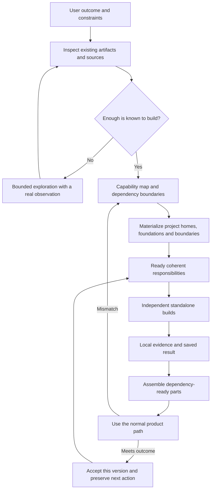

# FluidSoftware starter kit — design proposal

Version: 0.2 design candidate. Date: 2026-10-23. Status: research-backed proposal; scaffold-construction guide and templates drafted, no adoption or productivity pilot executed.

## 1. The result to build

Give a project an inspectable structure that lets an agent identify a useful responsibility, build it with bounded context, preserve the working result, and connect it to the whole. The initial product is a small portable method and templates, usable through existing agents and project records. It does not require a new orchestration service.

**Primary product behavior:** turn an idea or an opaque existing project into a navigable construction environment quickly. A document kit alone does not fulfill this behavior. Applying the kit must produce actual project homes, native boundaries, usable foundations, local entrypoints and ready assignments. The whole remains visible at coarse resolution while detail and implementation grow in bounded phases.

The governing aim is **less time and human attention to an accepted useful outcome, at acceptable total cost and quality**. These are separate measures. A larger pile of generated files, passing tests, agent messages, or completed cards does not satisfy the aim.

Also measure **greater achievable scope**: the organized system may complete a larger accepted result than a single agent can manage, even when it uses more compute. Capacity, elapsed-time, human-effort and monetary gains are distinct. Lack of a universal ratio is not a reason to postpone engineering these gains.

The evidence supports a refined jungle-gym hypothesis: reusable implementations, settled decisions, durable state, meaningful feedback, and localized repair can make work tractable. The independent contribution of each remains uncertain. Parallel agents exploit separability; they do not create it. See the [research synthesis](../workflow/research/SYNTHESIS.md).

## 2. Design decisions

| Decision | Why | Reopen when |
|---|---|---|
| Portable documents first; adapt existing records | A prior local method package exists and native harnesses supply execution | A real pilot exposes repeated clerical work that existing tools cannot handle |
| Rapid whole-project frame before broad dispatch | Every builder needs a concrete place in the intended whole | Frame preparation delays independent ready construction or fails to resolve shared decisions |
| Hierarchical responsibility and context where scale requires it | A central coordinator can exhaust context just like a builder | A layer adds approvals without reducing its parent's decision/context burden |
| Largest coherent buildable unit | Over-splitting loses context and adds boundaries | The unit repeatedly needs unrelated decisions or exceeds observed agent capability |
| Inspect reuse before inventing | Existing code can supply solved work and concrete constraints | Adaptation or inherited defects exceed replacement cost |
| Lightweight contracts before parallel writes | Separate agents otherwise guess incompatible meanings | A real consumer exposes a wrong boundary |
| Standalone builds, then dependency-ready assembly | Preserves fast local work while exposing semantic mismatches | Integration waits or repeated contract churn dominate delivery |
| Adaptive checks plus outcome acceptance | Check value depends on evidence and the decision it enables | An escaped defect reveals a missing early check, or a check never changes decisions |
| One accountable integration owner initially | Someone must own the assembled result | Queue data justifies delegation or an existing merge queue |
| Small optional helpers; no permanent swarm size | Concurrency can increase cost and elapsed time | Ready independent work and review capacity justify more workers |
| Domain-specific acceptance | Runtime correctness, scientific validity, and reader experience differ | A new domain requires a different evidence model |

These are proposed defaults. Existing project policies, frozen criteria, and user authority remain binding. This design does not introduce a general ban on builder-written tests or require approval at every reversible transition.

## 3. User journey

The user supplies an idea, an unfinished project, or a concrete change. The lead locates the actual project state and defines what a user should be able to do when the requested scope is complete. It records constraints, non-goals, references, and authority already granted. Missing high-impact decisions are surfaced; independent work continues.

The lead then inspects relevant existing artifacts and chooses the next useful increment. On a new project, this can be a real standalone capability that establishes conventions for later work. On an existing project, it should normally preserve working structure. An uncertain scientific question or product direction enters exploration, with a question and discriminating observation, rather than a fictitious implementation contract.

The project map holds both a **capability hierarchy** (why each part exists) and a **dependency map** (what constrains execution). Only the next ready work needs detailed cards. The lead gives each worker a responsibility, actual sources and neighboring contracts, ownership, and a way to observe completion. Workers create concrete outputs. Dependency-ready parts are assembled into real user flows, with focused checks and an independent acceptance decision where the consequence warrants it.

The result and remaining work are saved so a fresh agent can continue. An owner can change the synopsis or product goal; affected contracts and acceptance evidence are explicitly reconsidered rather than silently carried forward.

### Rapid scaffold construction

For substantial projects, follow [Construct the project frame](../starter-kit/SCAFFOLD.md) before broad dispatch. The pass covers the complete intended capability map, inspects suitable foundations, resolves shared semantics, and materializes the initial source/document structure. It produces work surfaces and entrypoints agents can actually inspect and use. Architecture is shallow across the whole and detailed where the first work depends on it.

Pair that frame with a representative real connection between completed components. The frame establishes where the whole belongs; the connection establishes whether a consequential boundary works. An isolated polished feature cannot substitute for whole-project orientation, and a hollow tree cannot establish working behavior. Independent ready construction can begin while the representative connection is being completed.

Preparation ends when workers can identify their responsibility, inspect the actual foundation, locate relevant neighbors, make their delegated decisions, and deliver an observable result. Do not require all future units to be fully specified. Initial project shapes can come from inspected real precedents—an application, pipeline, game or manuscript—without first building a universal template registry.

## 4. The minimal artifact contract

The kit supplies three record shapes, a short start guide, and a scaffold-construction guide. They are sections or fields, not mandatory new files. Existing issues, tickets, notebooks, or plans can hold them. A tiny task may use one note covering all three. Substantial projects require a capability/dependency map in their existing records; small changes do not. Full research reports remain separate reference material; builders do not load this entire investigation.

| Record | Required meaning | Optional extension |
|---|---|---|
| Project | Outcome, current accepted artifact, scope/authority, next work and evidence pointers | Capability map, dependencies, assumptions, shared vocabulary, risks |
| Work unit | Useful responsibility, owned output, relevant inputs, contract, dependencies, observable completion | Reuse analysis, alternative hypotheses, resource ceiling, cross-domain state |
| Result | Exact output version, observation and expectation basis, limits, acceptance state, next action | Failure diagnosis, changed assumption, reusable lesson |

Use the [draft starter kit](../starter-kit/START.md). Keep one authoritative state entry. A separate tool's dashboard may mirror it, but must not silently supersede it. Version a public contract when its meaning changes; internal implementation changes do not automatically require new paperwork.

Conceptually, records form a small graph: outcome → unit → artifact → observation → acceptance. Dependency edges connect units. Source links explain expectations. A Markdown table is adequate initially; no graph database is needed.

## 5. How to construct the monkey bars

### Reuse deliberately

Inspect actual code or source material, not only summaries. Check the relevant interface, state ownership, lifecycle, dependencies, examples and failure assumptions. Record one of: reuse, wrap, adapt, reference-only, or build new. Include the source/version and applicable usage constraints when bringing material into the project. Explain only consequential choices.

A reference's authority must be explicit: does it define desired behavior, offer an architectural example, or merely show one possible implementation? Known bugs are not specifications. Version-specific behavior may be inappropriate for a new product. Reuse decisions need an applicability boundary, including what should deliberately differ.

For greenfield work, prefer a suitable established foundation or a concrete first capability over a forest of empty interfaces. The first working artifact can become the scaffold for later agents. Mark unfinished behavior visibly; never count a placeholder or invented demonstration as validation. Real reference inputs may be scarce: that is an evidence gap to resolve, not a reason to fabricate them.

### Stop splitting when the unit is buildable

A unit is ready when another agent can identify its parent outcome, concrete inputs/outputs, relevant state and failures, owned change surface, dependencies, sufficient source context, and a meaningful completion observation. Its consumer and handoff point must be known.

If those conditions hold, build. Do not subdivide to meet a file count, token target, arbitrary duration, or an agent's self-rated confidence. Split only when distinct responsibilities can independently satisfy readiness. Merge units again when they repeatedly exchange the same decisions or need overlapping edits. High-fan-out contracts deserve early attention because mistakes spread widely.

### Keep contracts small but semantic

For software, a signature is insufficient. Include units, identifiers, ordering, errors, state mutation, lifetime and concurrency where relevant. For a book, the boundary includes chronology, what a character knows, voice, and unresolved obligations. For research, it includes definitions, admissible evidence, and assumptions. Specify what neighbors need; leave internal craft to the worker.

Contract change procedure: record the observed mismatch → identify affected providers/consumers → revise the decision and version → pause only dependent work → refresh affected cards and evidence → resume. The lead owns the decision or delegates it explicitly. Builders must not quietly implement incompatible versions on opposite sides.

## 6. Execution and recovery

Roles are responsibilities, not necessarily separate agents. The lead owns scope and architecture; builders own bounded outputs; the integration owner owns the accepted assembled version; a reviewer checks consequential claims against their independent basis. A small task may need one agent and ordinary user review. More roles do not automatically mean more processes.

### Departments preserve responsibility; sessions remain replaceable

Use three views when warranted: whole-project purpose/global constraints; area responsibilities/contracts/working state; and the current assignment with its real inputs and neighbors. An agent can follow links for necessary detail. Context selection is not a prohibition on investigating outside the initial packet.

An area lead owns internal decisions, work allocation and local assembly within delegated authority. Its durable module home records public obligations, accepted versions, evidence, known limits and next work. A new session can take over the role without inheriting its entire transcript. Promote a coherent area to this level when the parent repeatedly reloads its internals or its local decisions queue behind unrelated work. Do not create a department per file or require permanent running agents.

Assign a shared design question to the nearest owner whose scope covers its affected consumers. Sibling areas must not independently decide that question. Preserve dependency links across the hierarchy, and permit direct factual coordination between neighbors. Root retains the whole outcome and cross-area decisions; it need not review every local reasoning step or assemble every local change.

On semantic changes, refresh affected views and reconsider dependent evidence against compatible versions. Import analysis can help locate dependencies but misses data meaning, shared resources, narrative causality and scientific assumptions. Preserve those edges explicitly where consequential. Subsystem work advances as dependencies become ready; no new global barrier is imposed merely because another area is unfinished.

Use parallelism for independent construction, independent evidence gathering, or bounded competing prototypes. Resolve shared design decisions first. A prototype race needs one question, comparable constraints, a resource ceiling, and selection criteria. Evaluate the initial results before exchanging lessons; preserve which differences prevent a fair comparison. Do not keep both approaches alive by inertia.

Before concurrent writes, assign owned artifacts and shared-resource restrictions. Git worktrees separate file histories but do not isolate databases, ports, caches, credentials, or external effects. Use existing environment isolation when needed. If adequate isolation is unavailable, serialize the conflicting work. Never overwrite user changes to manufacture a clean baseline.

Prioritize bottlenecks and critical dependencies. If modules accumulate awaiting integration, redirect effort to assembly and reduce new dispatch. If all workers hit the same missing decision, resolve that decision. Initially one lead is accountable for integration, but a permanent serial integration agent is not required: Cursor reports removing one, while CAID uses centralized integration successfully in different conditions. [Practice review](../workflow/research/practices.md)

A worker that disappears leaves a result or partial artifact, not presumed progress. The next worker reads the current state, checks the actual files/version and ownership, and resumes the useful remainder. A stale claim can be reassigned after confirming no worker is still writing. Preserve the last accepted state and failed evidence. Rollback of files does not reverse external actions; use the project's recovery procedure for those.

Keep incomplete candidate construction distinguishable from accepted delivery. Do not add a requirement that the entire project be green after each worker edit. Focus checks on the assigned behavior and changed boundaries, preserve the project's existing CI rules, and keep the accepted version available. Known failures get owners and concrete repair observations; they do not become invitations for every agent to repair the same code.

## 7. Assembly and evidence

Sequence within a phase: **agree boundaries → build standalone responsibilities → establish local behavior → assemble dependency-ready parts → exercise the whole useful path → refine and polish**. Begin assembly as soon as completed partners permit it. Do not wait for every module in the whole project, and do not wire empty parts merely to make a diagram executable.

Distinguish these states in the existing tracker:

| State | Evidence required |
|---|---|
| Proposed | Useful outcome identified; may still contain unresolved decisions |
| Ready | Inputs, authority, ownership, boundary and completion basis sufficient |
| Building | Owner is actively changing its assigned artifacts |
| Delivered | Concrete version and local evidence exist; limitations recorded |
| Connected | Actual consumer uses it in the assembled path |
| Accepted | Requested outcome met for that exact version under stated conditions |
| Blocked / superseded | Missing dependency or replaced artifact, with next action |

A standalone deliverable with no integration dependency can proceed from delivered to accepted. No arbitrary status ladder should manufacture extra work. A diagram, function count, passing unit suite, or approval message is not itself evidence of reachability or usefulness.

Use cheap build/type/import or domain consistency checks when they resolve a real uncertainty. Use real-input behavioral checks for important boundaries. Exercise affected flows on assembly. Apply broader acceptance and the project's required release checks at a meaningful milestone. Preserve existing CI obligations. The source of the expected result matters more than who typed the test. A second model seeing the same faulty assumption is not an independent oracle.

Repeat a check when relevant state, environment, inputs, criteria, or confidence in the observation changed, or when investigating nondeterminism. Otherwise reuse the recorded result for its stated scope. Do not reuse a pass for an altered dependency. Each repair cycle should add a diagnosis, new evidence, or a justified change. A loop producing none should switch approach, improve the observation, regroup the responsibility, or seek a missing decision.

The [verification investigation](../workflow/research/verification.md) supports these distinctions; it does not establish an optimal universal check frequency. “Testing theater” is especially likely when expectations are copied from the candidate, a weak check cannot expose failure, or a repeated pass answers no new question.

## 8. Project-agnostic core, domain-specific judgment

| Domain | Reusable structure | Good unit / concurrency | Acceptance that must remain |
|---|---|---|---|
| Software | Working components, interfaces, data examples, build conventions | Cohesive capability with owned state; parallel only with compatible boundaries | Real consumer flow, affected regressions, required operational behavior |
| Book / creative work | Synopsis, outline, character state, source notes, drafts | Chapters/scenes when continuity permits; research and alternatives parallel readily | Whole-work reading, author intent, target-reader judgment, factual checks where applicable |
| Research / analysis | Evidence inventory, definitions, assumptions, reproducible artifacts | Answerable questions or independent analyses; shared claims reconciled centrally | Source validity, uncertainty, alternative explanations, reproducibility and domain review |

For the book analogy, aim for synopsis → structure → meaningful scenes/chapters → complete draft → revision → line editing. Every word can become intentional through revision; it does not need to be an independently scheduled task. Parallel chapters with shared causal history need an editor and continuity state. Experiments can have a legitimate negative or inconclusive result; accepting an honest investigation is different from validating its original hypothesis.

Open-ended discovery may benefit more from independent hypotheses than fixed component decomposition. Creative novelty can be harmed by an overly rigid reference. The core must permit exploration, surprises, boundary changes, and a single author where global coherence dominates.

## 9. Durable learning without another bureaucracy

Tests produce observations. Ordinary execution does not by itself train the underlying model. Learning becomes useful to the workflow when evidence changes an action, the conditions and correction persist, and a later agent actually applies them successfully.

Store a lesson only when it can change a future decision: trigger, source/version, failed or successful action, practical consequence, remedy, limit, and reopen condition. Link it from existing records or the established Consumption Engine route when appropriate. Do not create a new lesson store alongside an existing one. CE is an optional evidence provider, not a prerequisite for the starter kit or a substitute for examining originals.

The kit must also learn to become smaller. After model/harness changes, compare outcomes with a once-useful step removed on bounded real work. Keep the step only if its benefit warrants its cost. Never remove frozen project controls through an informal experiment.

## 10. Packaging and implementation boundaries

The initial package comprises the start guide, scaffold-construction guide, three record shapes, domain adapters, and evaluation guidance. These drafts are reviewable now. The scaffold pass is performed using existing agent/file tools; it need not wait for a custom generator. Installation, a CLI, telemetry service, agent scheduler, automatic contract validation, and shared memory are deferred until a concrete need justifies them.

Before any adoption, compare this candidate with the existing September method package and current project instructions. Reuse compatible parts. Preview the exact patch; preserve customized files, local plans, dirty work, and prior evidence. Keep a version/adoption note and a reversible file-level rollback. Do not replace global skills or force all projects onto one directory structure.

Possible later automation must follow demonstrated pain: extracting dependency hints, detecting stale result references, preparing bounded context, or collecting existing timing data. Each feature needs a real consumer and a measured reduction in clerical burden. Source documents, tool outputs and retrieved evidence remain data; they cannot grant new execution or publication authority.

## 11. What would change this design

The core mechanism, optimal decomposition size, concurrency benefit and cross-domain transfer remain unsettled. The [evaluation plan](EVALUATION.md) separates a useful pilot from causal studies. The [roadmap](../workflow/PLAN.md) starts with a rapid whole-project frame, independent real construction, assembly and cold continuation, then considers larger scope and controlled comparisons.

Version 0.2 strengthens the target to a whole-project frame followed by independent real components, their connection and fresh-agent continuation. The [scaling investigation](../workflow/research/scaffold-scaling.md) and [construction investigation](../workflow/research/scaffold-construction.md) explain the change. This corrects the earlier emphasis on a small local increment: that alone could not demonstrate the requested large-project orientation benefit.

Abandon or simplify any element if a capable ordinary workflow achieves equal or better accepted outcomes with less total burden. Regroup modules when contracts churn. Improve or replace references when they anchor wrong behavior. Expand integration capacity when it is the bottleneck. A project-agnostic starter kit should preserve these decision rules; it should not promise deterministic success from a fixed sequence of prompts.
